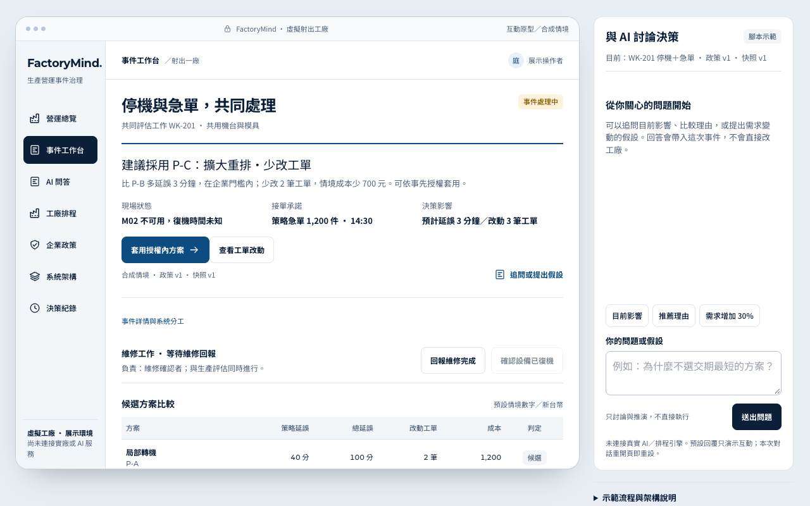

# FactoryMind Interactive Demo

**A clickable demo of an auditable AI operations agent that helps a factory handle a machine breakdown and a rush order at the same time.**

工廠 AI 營運助手的互動示範網頁：同時遇到停機與急單時，協助評估方案、套用、維修到結案。

> **Type** Course project (Intelligent Human–AI Interaction, NCCU) · **Status** Completed (2026-10) · **Role** Solo project · **Stack** Single-file HTML, CSS, JavaScript, Tailwind CSS

[Live demo](https://hunter20041004.github.io/nccu-coursework/115-1/%E6%99%BA%E6%85%A7%E4%BA%BA%E6%A9%9F%E4%BA%92%E5%8B%95/%E4%BD%9C%E6%A5%AD%EF%BD%9CFactoryMind%20%E4%BA%92%E5%8B%95%E7%A4%BA%E7%AF%84/)

## Background

A course assignment for Intelligent Human–AI Interaction. FactoryMind is also the concept my three-person team entered in a 2026 AI manufacturing competition; this interactive demo is my individual course work, focused on how a plant manager reviews and confirms what the AI proposes.

## What it does

- **Triggers a breakdown plus a rush order**, then compares candidate plans side by side.
- **Lets the manager adjust company policy thresholds**, preview the effect, and re-evaluate.
- **Shows work-order changes before and after**, maintenance reports and restart confirmation.
- **Closes the case** only after required steps are done, and exports a text report.
- **Works on desktop and mobile**, with a scripted AI Q&A panel.

## Key decisions

| Decision | Why |
| --- | --- |
| Policy changes are previewed and confirmed before re-evaluation | Production changes are costly to reverse, so the manager sees the effect first and stays accountable. |
| Confirming a restart forces a re-evaluation before applying | Stops a plan made under old conditions from being applied to a changed situation. |
| One self-contained HTML file | Anyone can open it from a link with no setup. |

## Results

- Live demo that runs in any browser, on desktop and mobile (see screenshots in [`screenshots/`](screenshots/)).

## Run it locally

No install needed: use the live demo, or open `index.html` in a browser.

## Notes

All data is a synthetic scenario and plan figures are preset demo values. The AI Q&A is scripted and not connected to a real factory, model or scheduler. Roles illustrate responsibilities, not account permissions. Progress resets on reload; download the report to keep it. Fonts and Tailwind load from external CDNs.

## 中文摘要

智慧人機互動課的個人作業。模擬工廠同時遇到停機與急單：比較候選方案、調整政策門檻並預覽、查看工單前後差異與維修回報，完成必要步驟後才能結案並下載報告。所有資料都是合成情境，AI 問答為預設腳本。FactoryMind 這個構想也是我和兩位隊友參加 2026 AI 製造競賽的題目。
